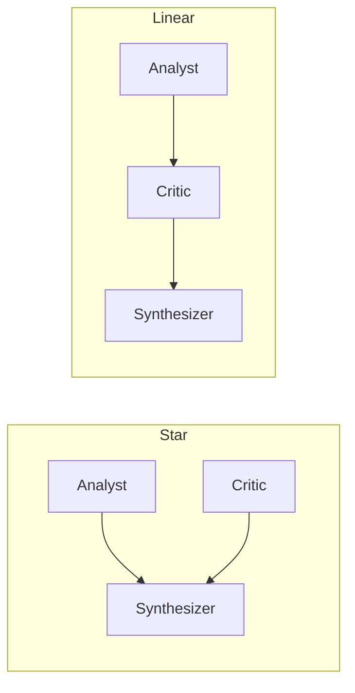
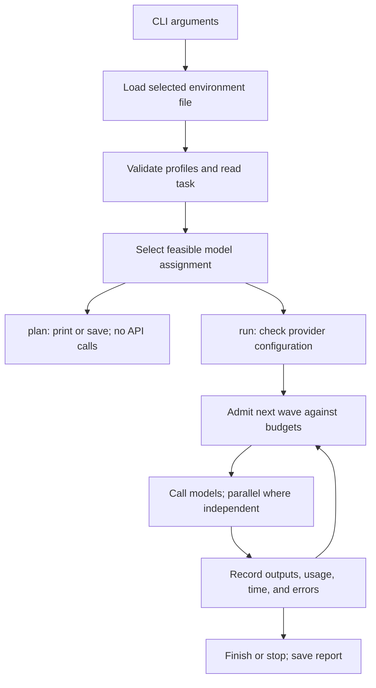

# Implementation and AgentBalance concepts

This document describes the **default fixed baseline path** (cheap/strong/balanced), including `.env`, provider transport, and budget accounting. For the current learned controller, see [the method comparison](METHOD_COMPARISON.md) and [paper pipeline](PAPER_PIPELINE.md). Statements below about absent training or three-agent sets describe the original default baseline only. Configured role templates also apply to fixed baselines.

Provider configurations contain three candidates and a uniform `medium` baseline. The original `balanced` algorithm below still mixes cheap/strong. Use [the paper pipeline](PAPER_PIPELINE.md) for current training commands. Default traces now omit repeated prompts and intermediate agent text; see [logging](EXPERIMENTS.md#logging).

## 1. Purpose and scope

The project lets you compare two model profiles across two communication graphs on the same task. It runs as a Python 3.11+ command-line application with no third-party runtime dependencies. The orchestration, planning, and reports run locally. Groq and Azure inference run remotely; Ollama inference can run locally.

The default baseline has three fixed roles, one pass through a graph, and up to three calls per run. Configured role rosters can increase that count. Failures or budget stops can end a run earlier. Baseline chat has no training job, automatic grader, external tool execution, or persistent conversation memory; research commands provide training and separate benchmark grading.

The default configuration uses mock responses. These demonstrate orchestration and accounting without credentials or charges. They are explicitly labeled fixtures and do not answer the task substantively.

## 2. How AgentBalance informed the design

AgentBalance treats model backbones and agent communication as coupled design choices under cost and latency constraints. Its pipeline generates heterogeneous agents, then builds an adaptive communication topology. [Paper, sections 2–3](https://arxiv.org/pdf/2512.11426).

| Research concept | Treatment in this project |
| --- | --- |
| Backbone-oriented agent generation | Cheap and strong profiles can be assigned to different roles. |
| Model profiling and pool construction | Manual capability, price, and latency values; no Pareto filtering or clustering. |
| Difficulty-aware pool selection | User supplies a difficulty value; a simple utility formula changes demand. |
| Query-conditioned role–backbone matching | Fixed role weights and two-profile enumeration replace learned matching. |
| Agents and communication represented as a DAG | Explicit role nodes and directed edges determine message flow. |
| Latency-aware topology synthesis | Two user-selected fixed graphs with critical-path estimates; no topology synthesis. |
| Learned representations, agent gating, end-to-end optimization | Not implemented; no agents are pruned and no parameters are trained. |

These research concepts are described in [sections 3.1–3.3 of the paper](https://arxiv.org/pdf/2512.11426). The [authors' repository](https://github.com/usail-hkust/AgentBalance_) is a reference, not an installed dependency. Authors' source code and controller weights are not bundled. Explicit benchmark downloads are stored separately under ignored `data/`.

The implementation is an **inspired baseline experiment**, not a reproduction of AgentBalance. The graph shape is selected before planning so its communication cost can be estimated. Model assignments are then selected before execution. This does not implement a system that learns a topology after choosing backbones. The utility formula and role weights below are local PoC decisions, not equations from the paper.

## 3. Agent roles and graphs

| Role | Instruction and responsibility |
| --- | --- |
| Analyst | Analyze the original task and propose a concise solution with supporting facts. |
| Critic | Identify mistakes, constraints, and counterexamples; correct a supplied proposal or work independently. |
| Synthesizer | Reconcile contributions and produce the final self-contained answer. |

Every node receives the original task. Each incoming edge adds its source agent's answer to the destination prompt. Contributions are labeled as fallible task data. The model is not given API keys or transport settings in its prompts.



**Star** has two execution waves: analyst and critic run concurrently, then synthesizer runs after both succeed. It is an inward star with the synthesizer as the hub. There is no separate initial coordinator call.

**Linear** has three execution waves: analyst, critic, synthesizer. Only direct predecessor output is forwarded. The synthesizer sees the critic's contribution rather than an independently forwarded copy of the analyst's original output; the critic is instructed to supply a corrected solution.

Only the first `context_chars` characters of each incoming contribution are forwarded. Complete outputs remain in the report. The original task is not truncated. There are no iterative rounds or additional summarization calls.

## 4. Model profiles and assignment policies

JSON configuration stores profiles. The active pool is exactly the two IDs named by `cheap_model` and `strong_model`; extra entries in `models` are not automatically selected. Different IDs are required, but the application cannot determine whether the underlying deployments are actually different or stronger. Those labels describe your intended experimental treatment.

| Policy | Behavior |
| --- | --- |
| `cheap` | Assign the cheap profile to every role. |
| `strong` | Assign the strong profile to every role. |
| `balanced` | Evaluate up to eight assignments and select the feasible assignment with the highest utility proxy. |

The balanced policy defaults to at most one strong agent. `--max-strong-agents` permits 0 through 3. The cap does not apply to the strong baseline. A baseline that cannot fit its estimated budgets is rejected rather than downgraded.

The local heuristic uses:

```text
demand = 0.35 + 0.65 * difficulty
role weights = analyst: 1.0, critic: 1.2, synthesizer: 2.0
utility = sum(role_weight * min(assigned_model_quality, demand))
```

`difficulty` is supplied by the user in [0, 1], defaulting to 0.5. `quality` is also a manual [0, 1] rating. The task text is used in prompts and cost estimates; there is no semantic difficulty classifier. Equal-utility candidates are ordered by lower reserved cost, then lower estimated latency.

With default profiles, the cheap quality is 0.35 and strong quality is 0.9. At default difficulty, demand is 0.675, making an upgrade worth 0.325 utility for analyst, 0.39 for critic, or 0.65 for synthesizer. If the budget permits one upgrade, the synthesizer wins. At difficulty zero, all roles' demand is already met by the cheap model.

These values do not measure correctness. They make the selection rule explicit and inspectable until measured model profiles or a learned selector are introduced.

## 5. Planning and runtime budgets

### Cost planning

Each assignment is checked against a USD budget. Input reservations use a tokenizer-independent proxy: UTF-8 content bytes plus 32 units of overhead per message and 32 additional units per prompt. Planning uses four-byte placeholder characters for the maximum forwarded context at each edge. Each call also reserves the configured maximum output tokens.

```text
cost = (input_tokens * input_usd_per_million
        + output_tokens * output_usd_per_million) / 1,000,000
```

This byte-based proxy is intentionally conservative and may reject runs that would actually fit. It is not an exact tokenizer or a guaranteed provider billing upper bound.

### Latency planning

Profile latency is the estimated duration of one call. Planning adds the longest call in each wave:

```text
star latency   = max(analyst_latency, critic_latency) + synthesizer_latency
linear latency = analyst_latency + critic_latency + synthesizer_latency
```

Profile latency is manually configured and does not vary with task length in this version. Reported runtime latency is measured separately with a monotonic clock.

### Runtime admission and accounting

Before any live requests, selected models are checked for required environment values and acceptable endpoint configuration. This does not contact the provider or verify credentials remotely.

Before each wave, the runner builds the actual prompts and reserves the cost of **all calls in that wave together**. If they exceed the remaining budget, none of that wave starts. This avoids competing parallel calls each treating the same funds as available.

Successful responses replace reservations with usage-based accounting. Provider token counts are preferred; missing counts are filled using prompt reservations and the output cap. Failed calls with unknown usage record an unknown reserved amount. Already completed parallel siblings still contribute their usage if another sibling fails.

Socket timeout is the smaller of the configured request timeout and the remaining latency budget at wave admission. Elapsed time and cost are checked before continuing. There are no automatic retries, provider fallbacks, or hidden inference calls.

Budgets are **best effort**. Provider work can continue after a timeout, byte estimates can be inaccurate, and socket timeouts are not strict total deadlines. Reported costs apply configured rates and exclude cache discounts, taxes, special fees, and separate billable categories. A provider account limit is needed for enforceable billing control.

## 6. Providers and request handling

| Provider | Implemented path |
| --- | --- |
| `mock` | Local labeled fixture, synthetic token counts, and bounded simulated delay. |
| `groq` | Template uses `/openai/v1/chat/completions`, bearer authentication, and `max_completion_tokens`. |
| `azure` | Template uses a full configured chat URL, deployment name, `api-key`, and `max_completion_tokens`. |
| `ollama` | Template uses local `/v1/chat/completions`, no key, and `max_tokens`. |

The shared REST adapter supports both `chat` and `responses` protocols. Every profile can set its own endpoint, credential-variable name, authorization header, and token-limit field. This supports mixed-provider graphs. Deployment compatibility still depends on the model's supported request parameters.

Groq support uses its documented [Chat Completions request format](https://console.groq.com/docs/api-reference). A Groq key is configured through `GROQ_API_KEY` and the Groq endpoint.

The transport uses Python's standard `urllib`. It sends non-streaming JSON requests with `User-Agent: AgentBalance-PoC/0.1.0` and `Accept: application/json`, enforces a 4 MB response limit, permits HTTPS or localhost HTTP, and rejects redirect following. Errors report status or failure category without echoing provider response bodies. The classifier reads at most 8 KB of an HTTP error body to recognize gateway error 1010 and organization/project model-permission codes; only predefined explanations are displayed. `extra_body` can add supported model options, but cannot override core routing, output caps, streaming, tools, or response multiplicity. No temperature is supplied by default.

Chat usage is read from `prompt_tokens` and `completion_tokens`; Responses usage is read from `input_tokens` and `output_tokens`. Reasoning-token details are not added again to aggregate counts. A provider that reports extra billable usage separately needs a corresponding accounting extension.

An empty answer stops the graph while preserving reported usage. Failed, cancelled, queued, or still-in-progress Responses results are treated as errors. A nonempty truncated answer can proceed, with a warning about its finish reason.

## 7. Configuration and `.env` files

Configuration is split into model profiles and environment values:

| Location | Contents |
| --- | --- |
| `.env` | Your keys, model/deployment names, Azure request URL, and optional local model name. |
| `.env.example` | Blank tracked template with all supported environment variable names. |
| `config.local.json` | Your chosen profiles, prices, quality ratings, and execution settings. |
| `configs/*.example.json` | Starting profiles for Groq, Azure, or local Ollama plus Azure. |
| `agentbalance/demo.json` | Bundled offline profiles used when `--config` is omitted. |

Fill only the providers you use. For example:

```dotenv
GROQ_API_KEY=your-groq-key
GROQ_CHEAP_MODEL=your-cheaper-model
GROQ_STRONG_MODEL=your-stronger-model

AZURE_API_KEY=your-azure-key
AZURE_CHAT_ENDPOINT=https://YOUR-RESOURCE.openai.azure.com/openai/v1/chat/completions
AZURE_CHEAP_DEPLOYMENT=your-cheaper-deployment
AZURE_STRONG_DEPLOYMENT=your-stronger-deployment

OLLAMA_MODEL=your-installed-local-model
```

Loading rules:

1. The CLI reads `.env` in the current working directory before model configuration.
2. `--env-file PATH` selects a different file instead; it must exist.
3. `--no-env` disables file loading. A missing default `.env` is allowed.
4. Existing process variables take precedence, even if empty.
5. The loader accepts single-line assignments, optional quotes or `export`, and comments. Values are literal, with no shell execution, variable substitution, escape processing, or multiline support.
6. Duplicate keys use the final file value unless the variable already exists in the process.
7. The complete file is parsed before environment mutation. Invalid syntax reports a location without echoing values.

The JSON `api_key_env` value stays a name such as `GROQ_API_KEY`. JSON endpoint and model strings can separately use `${VARIABLE}` substitution. File loading only changes the Python process environment. Direct Python callers must invoke `load_env()` explicitly if desired.

`.env` and `.env.*` are ignored by Git, with an exception for `.env.example`. The local config and results are also ignored. Reports contain task data and answers, but credential headers are not included. Git ignore rules do not encrypt files or revoke any previously committed secret.

### JSON field reference

| Top-level field | Meaning |
| --- | --- |
| `cheap_model`, `strong_model` | IDs of the two active profiles. |
| `models` | List of model profiles. |
| `max_output_tokens` | Per-call generation limit; default 256, Groq template 2048, Azure templates 1024. |
| `context_chars` | Forwarded characters per incoming edge; default 1200. |
| `request_timeout_seconds` | Per-request socket timeout cap; default 60. |

| Model field | Meaning |
| --- | --- |
| `id` | Unique local profile ID. |
| `provider` | `mock`, `groq`, `azure`, or `ollama`. |
| `model` | Model ID or deployment name; can use `${VARIABLE}`. |
| `quality` | Manual capability proxy in [0, 1]. |
| `input_usd_per_million`, `output_usd_per_million` | Nonnegative numeric prices. `null` is rejected; zero means zero modeled API cost. |
| `latency_seconds` | Nonnegative estimated call duration. |
| `endpoint` | Complete request URL, including any required query string. |
| `api_key_env` | Variable name containing the credential; may be empty for Ollama. |
| `protocol` | `chat` or `responses`. |
| `auth_header` | `Authorization` or `api-key`. Authorization values receive a Bearer prefix. |
| `token_limit_field` | Chat field: `max_tokens` or `max_completion_tokens`; Responses always sends `max_output_tokens`. |
| `extra_body` | Additional supported model request parameters, subject to reserved-field checks. |

Model prices in live templates deliberately start as `null`. Enter your deployment's rates before running. A local profile's zero API fee excludes hardware and electricity. Strong/cheap ratings and latency estimates are examples, not provider performance claims.

## 8. Commands and execution flow



| Command | Behavior |
| --- | --- |
| `chat` (also the default with no command) | Select provider, policy, and topology, then read terminal queries or `/file PATH`, execute each independently, and save a unique JSON report per query. `/exit` or end-of-input ends the session. |
| `plan` | Preview one assignment without provider preflight or API calls. |
| `run` | Execute one topology/policy and write a JSON report; prompt for provider, policy, topology, and one query if no task argument is supplied. |
| `compare` | Plan both topologies under all three policies, then execute feasible runs and export JSON plus CSV. |

Common flags include `--config`, `--task` or `--task-file`, `--env-file` or `--no-env`, `--budget`, `--latency-budget`, `--difficulty`, and `--max-strong-agents`. Plan/run/compare accept `--out`; chat saves unique reports under `results/`. Chat/plan/run also accept `--topology` and `--policy`. Defaults are star, balanced, $0.02 per run, and 120 seconds per run.

Chat can start with an optional `--task` or `--task-file`, then continues prompting. `/file` reads a UTF-8 document (including an optional BOM) as one task, preserving its line breaks. Each query starts a fresh graph without conversation history. Blank terminal input is ignored; unreadable or empty files report an error and allow another input. Chat reports execution errors and allows the user to try another query without automatic retries.

Chat and run without a task ask for provider, policy, then topology at startup. Menus accept names (case insensitive) or numbers; policy defaults to balanced and topology to star on Enter. `--provider groq|azure` skips the provider menu, `--config` supplies a configuration instead, and `--policy` and `--topology` skip their respective menus. All three choices remain fixed for the session. End-of-input or `/exit` at any menu exits without running a query.

Provider selection prefers `configs/<provider>.local.json` in the working directory, then `config.local.json` if both pool profiles match the provider, then the repository's `configs/<provider>.example.json`. Invalid configurations fail explicitly; unset prices must be supplied before execution. A provider-specific local configuration must use that provider for both pool profiles. Interactive commands print the selected path, providers, and policy at startup. Plan/compare and run with a task retain the packaged offline default unless `--provider` or `--config` is supplied. Local provider configurations are ignored by Git.

Comparisons execute runs sequentially; concurrency occurs inside star graphs. They skip infeasible plans, preserve completed results after each run, and abort remaining experiments on an agent error. Budget-stop outcomes do not automatically abort other independent comparison runs. Each run gets its own budget; six runs at $0.02 have a combined configured budget of $0.12. This is not an additional globally enforced account cap.

```powershell
# Offline demonstration
python -m agentbalance compare --task-file examples/task.txt

# Live setup: fill .env and replace null prices in the copied JSON first
Copy-Item configs/groq.example.json config.local.json
python -m agentbalance plan --config config.local.json --task-file examples/task.txt --budget 0.05
python -m agentbalance run --config config.local.json --task-file examples/task.txt --budget 0.05

# Separate environment file
python -m agentbalance run --env-file .env.azure --config config.local.json --task "Explain binary search"
```

For the final command, `config.local.json` must contain Azure profiles. Environment files supply values; they do not switch providers by themselves.

Exit codes are 0 for successful command completion, 1 for unsuccessful execution (or no executed comparison runs), 2 for configuration/input errors, and 130 for interruption. Comparisons can exit 0 when all executed runs succeed even if some plans were skipped; inspect `skipped` in the report.

Chat exits 0 on `/exit`, `/quit`, or end-of-input even if an earlier query failed; inspect the individual reports for query status. Ctrl+C exits 130.

## 9. Reports and interpretation

Unless `--out` is supplied, run/compare reports receive a timestamp and unique suffix under `results/`. Plan writes a file only when `--out` is supplied.

| Report section | Recorded information |
| --- | --- |
| Identity | UTC creation time, original task, mode, status, error. |
| `plan` | Policy, topology, edges, model assignments, utility proxy, difficulty, budgets, estimated cost/latency. |
| `settings` | Output limit, forwarded context limit, request timeout. |
| `model_profiles` | Selected profile IDs, resolved model names, provider labels, ratings, prices, estimated latency. |
| `agents` | Role, parents, prompt messages, start/duration, answer, finish reason, token counts, usage source, cost, reservation, status/error. |
| `totals` | Summed known/estimated cost and tokens, unknown reserved cost, completeness flag, elapsed time, calls. |
| Answer/warnings | Synthesizer output if available, usage/finish-reason warnings. |

Modes are `offline_simulation`, `mixed_simulation`, or `live`. Usage sources are `simulated`, `provider`, `estimated_reservation`, or `unknown`. Run statuses are `completed`, `error`, `budget_stopped`, and `budget_exceeded`.

`cost_complete` means every attempted call has an accounted cost value; it does **not** mean the amount is an exact bill. Missing-usage reservations can still produce `cost_complete: true`. Unknown-call costs are excluded from `cost_usd` and separately identified. Token totals similarly sum known or estimated values. A run may retain its final answer even if its measured budget was exceeded.

Comparison CSV includes topology, policy, status, mode, cost, cost completeness, tokens, elapsed time, call count, and final answer. Full traces and skipped-plan explanations remain in JSON. Do not interpret mock quality ratings, simulated timings, or a utility score as measured answer accuracy.

The terminal summary includes each failed agent's specific error alongside the overall run status. Standard output and standard error retain their configured encoding, with a backslash-escape fallback for unrepresentable characters. This prevents a Windows encoding error from hiding an otherwise successful run and its report path. JSON output remains UTF-8 with the original answer text.

## 10. Files and validation

| File or directory | Responsibility |
| --- | --- |
| `agentbalance/__init__.py`, `__main__.py` | Package identity and module entry point. |
| `agentbalance/cli.py` | Commands, arguments, experiment loop, console output, JSON/CSV export. |
| `agentbalance/env.py` | Environment-file parser and process-variable precedence. |
| `agentbalance/config.py` | Dataclasses, model lookup, numeric validation, request-option validation. |
| `agentbalance/graph.py` | Three role prompts, two edge lists, wave ordering, context assembly, token proxy. |
| `agentbalance/planner.py` | Assignment enumeration, utility ranking, cost/latency feasibility. |
| `agentbalance/providers.py` | Mock responses, REST requests, authentication, response parsing, sanitized errors. |
| `agentbalance/runner.py` | Preflight, wave execution, admission checks, usage accounting, traces. |
| `agentbalance/demo.json` | Default simulated profiles. |
| `configs/` | Groq, Azure, and local-plus-Azure configuration templates. |
| `examples/task.txt` | Shared example task for baseline comparisons. |
| `tests/test_core.py` | Planning, graph execution, accounting, failure handling, CLI exports. |
| `tests/test_providers.py` | Local HTTP contract tests and end-to-end graph requests. |
| `tests/test_env.py` | Parsing, precedence, automatic/custom/disabled loading, and credential handoff. |
| `pyproject.toml` | Package metadata, optional installed command, bundled demo configuration. |
| `.gitignore`, `.env.example` | Local artifact exclusions and blank environment template. |
| `README.md`, `docs/IMPLEMENTATION.md` | Setup guide and implementation record. |

Run validation with:

```powershell
python -m unittest discover -s tests -q
python -m unittest discover -s tests/research -q
```

The baseline tests check parallel execution with a synchronization barrier, direct predecessor message flow, zero-budget selection, infeasible plans, context bounds, budget overruns, partial failure accounting, and comparison exports. Provider tests use a local HTTP server to check request structure, auth headers, output limits, usage parsing, redirect refusal, and no retries, including Groq template loading and a complete graph over HTTP. Regression tests cover the application identification header, safe HTTP error classification, visible per-agent errors, and Unicode answers on an ASCII terminal. Environment tests use temporary files and synthetic credentials, including checks that parse errors do not expose values. The research suite covers controller learning, paper-mode behavior and pipeline recovery.

See [readable results](../reports/README.md) for recorded live experiments and their limitations. Tests verify implementation behavior; measured accuracy and efficiency require controlled benchmark runs.
